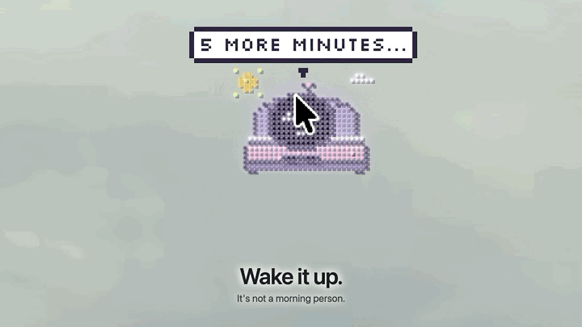

# Claude Usage: a tiny desktop pet for Claude

A pixel pet that lives on your Mac desktop. It runs on your Claude usage: the more you have left, the livelier it is.



**▶ [Download the full 60-second demo](https://github.com/yinuochenone/claude-desktop-pet/releases/latest/download/pet-demo.mp4)** (MP4, 40 MB)

## Install (1 minute)

Paste this into Terminal:

```bash
curl -fsSL https://raw.githubusercontent.com/yinuochenone/claude-desktop-pet/main/install.sh | bash
```

Then look for **✦** in your menu bar. Your pet is asleep in its bed in a corner of the screen.

**You need:** macOS 13 or newer (Apple Silicon or Intel). To see your usage numbers, you also need [Claude Code](https://docs.claude.com/en/docs/claude-code) installed and signed in. The pet works without it, but it won't know how much usage you have left.

<details>
<summary>Other ways to install</summary>

**Download the app**

1. Download `Claude-Usage.zip` from [Releases](https://github.com/yinuochenone/claude-desktop-pet/releases/latest).
2. Unzip it and drag **Claude Usage** into Applications.
3. Open it. macOS says it can't check the app for malware, because the app isn't notarized by Apple.
4. Go to **System Settings → Privacy & Security**, scroll down, and click **Open Anyway**.

**Build from source** (needs Apple's command line tools: `xcode-select --install`)

```bash
git clone https://github.com/yinuochenone/claude-desktop-pet.git
cd claude-desktop-pet
./build.sh
```

</details>

## What it does

| | |
|---|---|
| **Sleeps in a tiny bed** | Click the bed to wake it. It's not a morning person. |
| **Comes when called** | Press **⌃⌥P**. |
| **Explores** | It walks along windows, peeks into folders you open, and hops along your Dock. |
| **Plays hide and seek** | It hides behind windows. Hover over its hiding spot to find it. |
| **Pat it** | Click it for hearts and your Claude usage (session and week). |
| **Shake it** | Pick it up and shake. Gently. |
| **Eats your trash** | Drag a file onto it. It opens wide and eats it. The file goes to the Trash, never deleted. |
| **Runs on your usage** | The less Claude usage you have left, the sleepier it gets. |
| **Focus buddy** | Press **⌃⌥F** for a 25-minute session. It works at a little desk beside you. |
| **Notices you** | It naps when you step away, greets you when you're back, says good morning, and reminds you to sleep after 11pm. |

**Menu bar ✦:** focus sessions, call or hide the pet (**⌃⌥H**), themes, opacity, always on top, ghost mode (click-through), and Quit.

## Permissions it may ask for

- **Finder:** to find folders on your desktop to hide behind, and to move files it eats to the Trash.
- **Keychain:** to read Claude Code's login so it can fetch your usage. If macOS asks, click **Always Allow**.
- **Accessibility (optional):** so it can hop on your exact Dock icons.

## Privacy

- Your Claude login is only ever sent to `api.anthropic.com`, to fetch your usage limits.
- It reads token counts from Claude Code's local history (`~/.claude/projects`) on your Mac. That never leaves your Mac.
- No analytics, no tracking, no other servers.

## Uninstall

Click **✦ → Quit**, then drag **Claude Usage** from `~/Applications` to the Trash.

---

A fan project. Not affiliated with or endorsed by Anthropic.
